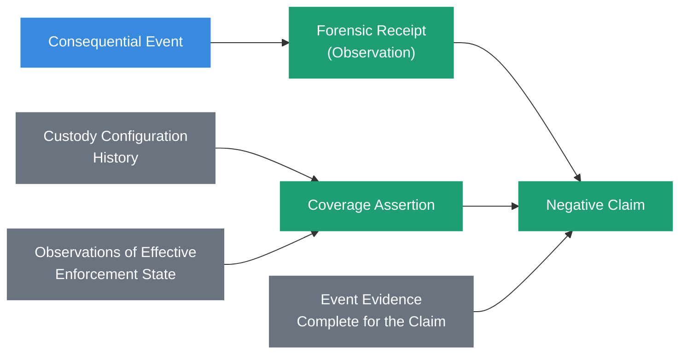
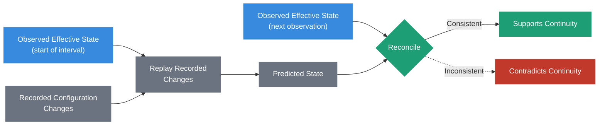

# Coverage Assertion



## Definition

A Coverage Assertion is a referenceable evidence artifact asserting that a defined boundary was authoritative and complete for a class of state or events during a defined interval, supported by evidence of the custody configuration in force throughout that interval.

It is a distinct evidence artifact, not a field of an individual [Forensic Receipt](forensic-receipt.html).

It has its own identity, scope, temporal validity, verification requirements, and trust dependencies.

Receipts and ledger segments that support a negative claim reference it. They do not embed it.

The governing principle is:

> **Observation records what a boundary saw. Coverage is the claim that nothing in scope could have bypassed it.**

## Origin

The term **Coverage Assertion** was proposed and contributed to the Sovereign Systems Specification by Nicolás Moreno ([@bimmer2003](https://github.com/bimmer2003)) in 2026, in [issue #1](https://github.com/kenwalger/sovereign-system-spec/issues/1) and [pull request #2](https://github.com/kenwalger/sovereign-system-spec/pull/2), and refined in discussion with Ken W. Alger.

## Why It Matters

A Forensic Receipt binds an event to the evidence observable at a boundary.

A ledger of integrity-valid receipts can therefore support the claim:

> _This boundary observed X._

It cannot, by itself, support the claim:

> _Nothing else of class Y happened during interval Z._

The second claim depends on something no individual receipt records: that the boundary was the only path to the state in question for the whole interval.

That guarantee comes from custody, not from the ledger.

Without an explicit artifact carrying it, a verifier must either take exclusivity on faith or reconstruct it from outside the evidence.

[Negative Evidence]({{ site.baseurl }}/#negative-evidence) already states that its adequacy "depends on the completeness and authority of the source." A Coverage Assertion is the artifact that makes that completeness and authority inspectable.

## Observation Is Not Coverage

These are different claims:

**Observation:** _this boundary observed X._

**Coverage:** _this boundary was authoritative and complete for class Y during interval Z._

Most receipts only need to support observation.

An ordinary receipt attesting to an observed event carries no completeness obligation, and a Coverage Assertion does not change that.

Coverage is required only where a receipt or ledger segment is used to support a negative claim.

## Anatomy of a Coverage Assertion

The exact schema is implementation-specific.

A Coverage Assertion should make explicit:

- its own identity and integrity material
- the claim class it covers: the class of state, events, or paths for which the boundary is asserted to be complete
- the boundary asserted to be authoritative for that class
- the interval over which the assertion holds
- the custody policy, and its version, that made the boundary exclusive
- the enforcement mechanism that left no other path, by reference
- the custody configuration history for the interval, by reference
- the observations of effective enforcement state used to reconcile that history, by reference
- the declared observation resolution: how frequently, and at which points, effective enforcement state was observed
- known exclusions: classes of state, paths, or principals outside the assertion
- known evidence gaps within the interval
- the witness or witnesses, and the trust anchors on which the assertion depends

Exclusions and gaps are part of the assertion.

> **A declared exclusion is stronger than a silent one, for the same reason a [Known Blind Spot]({{ site.baseurl }}/#known-blind-spot) is stronger than silent absence.**

## Coverage Is Temporal

Coverage has the same shape as [key authority](forensic-receipt.html#key-authority-is-temporal).

These are different questions:

> _Is this boundary exclusive now?_

and:

> _Was this boundary exclusive for class Y throughout interval Z?_

Custody configuration changes. A grant is added, a connector is registered, a network path is opened for an incident, an enforcement mechanism is reconfigured.

A policy version recorded at time T does not establish continuity across Z.

Each change to custody configuration that can affect what the boundary covers is a consequential event. It should be governed by [Write-Side Custody](write-side-custody.html) and witnessed like any other consequential event.

## Evidence of Continuity

Versioning and witnessing configuration changes is necessary. It is not sufficient.

A signed sequence of known changes does not, by itself, prove that no unobserved change occurred.

The change history must therefore be reconciled with evidence it did not produce: independent observations of the effective enforcement state, read from the enforcement mechanism itself rather than from the record of intended changes.

At a minimum, effective enforcement state should be observed at the bounds of the interval.

Replaying the recorded changes from one observation should reproduce the next.

The observations are themselves evidence. They should be witnessed, and where the assurance model requires it, checkpointed or anchored independently of the operator who controls the configuration.

The method of observation is implementation-specific. It may be a read of access-control state, network policy, hardware isolation state, or another mechanism appropriate to the boundary.

The requirement is the same: the observation must come from the mechanism that enforces, not from the record of what was meant to be enforced.

## The Limit of Observation Resolution

A declared observation resolution is not a guarantee that every transient configuration change within the interval would be detected.

A change introduced and reverted between two observations can remain invisible to reconciliation.

A supported Coverage Assertion is therefore always relative to the declared observation model, the evidence available, and the trust anchors the verifier accepts.

It is not proof of absolute completeness.

> **Coverage is evidenced at the resolution it declares, and no finer.**

This does not make coverage evidence weak. It defines its strength and scope, in the same way a [chain relationship](forensic-receipt.html#chain-relationships) supports verification relative to the trusted anchors available to the verifier.

## Verification Outcomes

Coverage must not become a Boolean that a producer can set to `true`.

A Coverage Assertion is verified, not declared verified.

Verifying it should produce one of three outcomes:

**Supported:** the assertion resolves, its custody policy and enforcement references resolve, the configuration history reconciles with every observation of effective enforcement state within the declared resolution, no evidence shows activity of the covered class outside the boundary, and the observations validate against the selected trust anchors.

**Contradicted:** evidence is inconsistent with the assertion. For example, an observation of effective enforcement state does not match the state predicted from the recorded changes, or a receipt or other evidence shows activity of the covered class reaching durable state through a path outside the boundary during the interval.

**[Undetermined]({{ site.baseurl }}/#undetermined):** the available evidence does not establish the assertion. For example, an observation at a bound of the interval is missing, a gap between observations exceeds the declared resolution, a referenced artifact is unavailable, or a trust anchor cannot be validated.

A verifier may ask:

1. Does the Coverage Assertion resolve, and does its integrity material validate?
2. Do its custody policy, enforcement, and configuration-history references resolve?
3. Were the custody configuration changes within the interval themselves witnessed?
4. Was effective enforcement state observed at the bounds of the interval, and at the declared resolution within it?
5. Does replaying the recorded changes from each observation reproduce the next?
6. Is there evidence of activity of the covered class outside the boundary during the interval?
7. Do the observations and their witnesses validate against the selected trust anchors?
8. Are exclusions and known gaps declared, and do they intersect the claim being supported?
9. Has later evidence superseded, corrected, invalidated, or weakened the assertion?

Exclusions and gaps do not automatically produce `undetermined`.

A claim that falls entirely outside a declared exclusion or gap may still be supported. A claim that depends on an excluded path, or on a gap, cannot be supported by the assertion.

> **A producer may declare coverage. Only verification can support it.**

## Coverage Is Not a Negative Claim

A supported Coverage Assertion does not, by itself, establish a negative claim.

It establishes that the boundary was authoritative and complete for the covered class during the interval, at the declared resolution.

The negative claim also requires that the relevant event evidence produced at that boundary be sufficiently complete for the claim: the ledger segment must cover the interval, be intact relative to its trust anchors, and be within the assertion's claim class.

Both are necessary:

- coverage without complete event evidence shows that nothing could bypass the boundary, but not what the boundary recorded
- complete event evidence without coverage shows what the boundary recorded, but not that nothing bypassed it

> **A negative claim needs both: the boundary saw nothing, and nothing could go around it.**

## Relationship to Forensic Receipts

A [Forensic Receipt](forensic-receipt.html) binds a consequential event to the evidence observable at a boundary.

A Coverage Assertion asserts that the boundary was the only path for a class of events during an interval.

A receipt that supports only observation needs no Coverage Assertion.

A receipt or ledger segment that supports a negative claim should reference the Coverage Assertion it depends on, by identity and integrity material, rather than embedding its contents.

Multiple receipts and ledger segments may depend on the same Coverage Assertion.

## Relationship to Negative Evidence

[Negative Evidence]({{ site.baseurl }}/#negative-evidence) directly supports a negative claim, and its adequacy depends on the completeness and authority of the source.

A Coverage Assertion is the evidence-level form of that completeness and authority for a boundary over an interval.

Without one, negative evidence drawn from a boundary's records rests on an unstated assumption that the boundary was exclusive.

## Relationship to Write-Side Custody

[Write-Side Custody](write-side-custody.html) governs admission to durable state.

A Coverage Assertion depends on custody in two ways.

Custody is what makes the boundary exclusive, so the assertion references the custody policy and enforcement mechanism that did so.

Changes to custody configuration are consequential events, so the assertion depends on custody having governed and witnessed those changes for the interval.

The assertion does not make custody exclusive. It preserves the evidence by which a later verifier can evaluate whether it was.

> **Custody enforces. The ledger witnesses. Coverage evidences that custody had no gaps in scope.**

## Relationship to the Reasoning Ledger

The [Reasoning Ledger](reasoning-ledger.html) records observable evidence surrounding consequential decisions and operations.

A Coverage Assertion may scope a ledger segment: it states for which class and interval the segment's absence of an event can be read as evidence of absence.

The ledger records what happened at the boundary. The Coverage Assertion records why the ledger's silence about something else is meaningful.

## The Sovereign Approach

Sovereign Systems distinguish what a boundary observed from what a boundary was complete for.

A conforming design should:

- distinguish observation from coverage
- require a Coverage Assertion only for receipts or ledger segments that support negative claims
- make the Coverage Assertion a referenceable artifact with its own identity, scope, interval, and integrity material
- reference the custody policy and enforcement mechanism on which coverage depends
- treat custody configuration changes as consequential events that are governed and witnessed
- reconcile configuration history with independent observations of effective enforcement state
- declare the observation resolution, and not claim detection finer than it
- declare exclusions and known evidence gaps as part of the assertion
- verify coverage to an explicit outcome of `supported`, `contradicted`, or `undetermined`, never to a producer-set Boolean
- require complete event evidence in addition to supported coverage before supporting a negative claim
- remain neutral as to the database, transaction model, or enforcement mechanism used

The objective is not to prove that nothing unobserved could ever have happened.

The objective is to make the completeness a negative claim depends on into evidence that a later verifier can evaluate, with its scope, resolution, and trust dependencies stated.

## Related Terms

- [Forensic Receipt](forensic-receipt.html)
- [Write-Side Custody](write-side-custody.html)
- [Reasoning Ledger](reasoning-ledger.html)
- [Provenance](provenance.html)

## References

- Sovereign Systems Epistemic Model
- Sovereign Systems Specification
- Integrity & Provenance Vector
